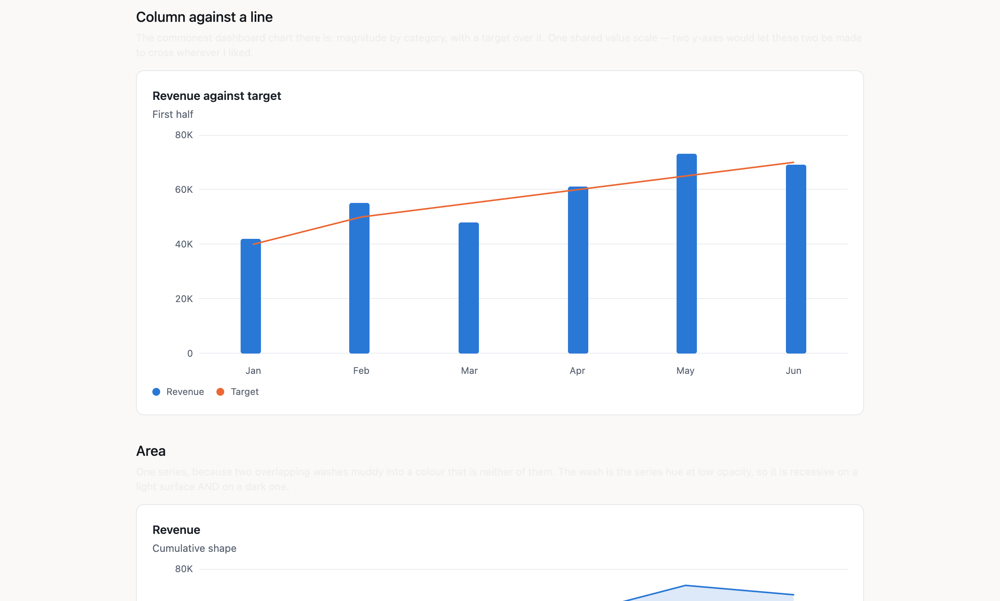
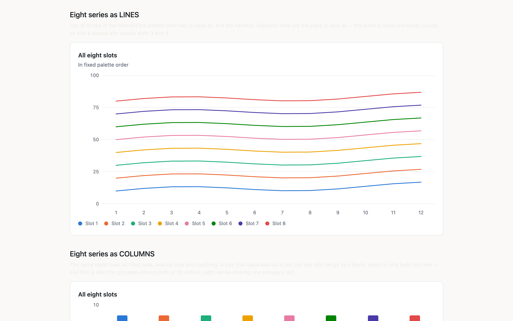

# Osysharp.Charts — charts in pure Osy#

Line, area, column, bar, scatter and OHLC candle charts over one shared value scale, plus pie and donut — drawn from
your app's own data, with no JavaScript and no bundle to ship.

## Use case

Dashboards and reports inside an Osy# app: revenue against target on a sales overview, a sparkline in a table row,
the share of orders by channel, a price history on a trading screen. You pass the numbers you already query. Because
every chart is ordinary Osy# components rather than a canvas, it renders on the server's first paint, is readable by
keyboard and screen reader without extra work, follows your app's theme in light and dark, and can show the same data
as a real table beside it or in its place.





## Install

```osy
// app.osy
app Dashboard {
  use Osysharp.Charts@1;
  model "model/**/*.osy";
}
```

```console
osy lock      # resolves the package and pins its content address in osyrin.lock
```

## Using it

```osy
using Osysharp.Charts;

Chart(title: "Revenue against target", subtitle: "First half", labels: months) {
  Column(label: "Revenue", values: revenue);
  Line(label: "Target", values: target);
  Axis(side: Left);
}
```

The marks are written as CHILDREN — they are config records, so the call site reads as the picture being described
rather than as an array being assembled. Giving the chart `labels` is what asks for a category axis; you rarely
declare `Axis(side: Bottom)`.

A bare enum member is the spelling here (`side: Left`), exactly as in any other component call — `AxisSide.Left`
also works and is what you would write in C#.

## What it does

| | |
|---|---|
| marks | line, area, column and horizontal bar (GROUPED when there is more than one series, or `stacked: true`), scatter, OHLC candle — and `Pie`/donut as a sibling component |
| axes | a value axis with round-number ticks, a category axis, optional gridlines, a **title**, an explicit **min/max**, a value **format** and **prefix/suffix** |
| signed values | a **negative** value grows from the zero line, downwards on a column chart and leftwards on a bar; the axis opens below zero to make room, and a mixed-sign stack splits at the line |
| hover | a crosshair and a readout naming **every** series' value in the hovered category |
| legend | automatic for two or more series, swatch + name; `position:` on any edge or `None`, `interactive: true` to toggle a series off |
| palette | eight validated hues in fixed order, never cycled |
| annotations | a reference `Rule`, a shaded `Band`, a labelled `Note` — none of them a series |
| table | `Table()` below the chart, or `Table(position: Instead)` in place of it — a real grid |
| bare mode | `chrome: Bare` — the sparkline: no card, axes, gridlines, legend, heading or hover |
| states | an empty state; a chart with one series draws no legend |

### The hover readout

One invisible band of full-height cells sits over the plot, one per category. Hovering a cell reveals a crosshair
and a readout of every series at that category — the shared-crosshair behaviour a line chart wants, which happens to
be right for columns and dots too. **One rule for every mark kind**, so what you learn on a bar chart holds on a line
chart.

It is still no JavaScript: `inside HoverCell.Hover { Opacity = 1; }` is an ancestor-conditioned variant that lowers
to a descendant CSS rule. No pointer handler, no coordinates, no measurement. On a `<canvas>` this is hit-testing
against pixel coordinates, which is most of a charting library.

**And it stays inside the plot.** Centred on its cell, a readout at the first or last category would hang past the
edge and be clipped — losing exactly the label you hovered to read. It measures instead: the plot's width comes from
the hover band (whose root spans the plot), the readout's own from `Layout.TextWidth` over the lines it is about to
paint, and the difference becomes a shift that is **zero everywhere except the cells that would overflow**. A middle
category is still centred on its crosshair, which is what makes this a flip rather than a re-anchor.

⚑ **Measured from the TEXT, not from the box.** Asking `Layout.Width` for the readout's own width from inside
the readout lags its content by construction (109.0 against a painted 114.6), because the number describes one layout
pass and the content may be from another.
`Layout.TextWidth` is a pure function of the string and the font, so there is nothing to lag. The cost is that
`ReadoutWidth` must mirror `ReadoutBody`'s lines — change one, change the other.

### Annotations — a `Rule`, a `Band`, a `Note`

Things that are true about the chart but are **not in the data**: a target, an acceptable range, the day something
happened. Written as children, like a mark or an axis:

```osy
Chart(title: "Revenue against target", labels: months) {
  Column(label: "Revenue", values: revenue);
  Band(from: 55000.0, to: 65000.0, label: "Acceptable");
  Rule(value: 60000.0, label: "Target");
  Note(category: "May", value: 73000.0, label: "v2 launch");
  Axis(side: Left);
}
```

⚑ **AN ANNOTATION IS NOT A SERIES, and that is the whole design.** No legend entry, no palette slot (it has its own
ink), it cannot be toggled off, and **it does not move the scale** — because none of those things is true of "the
target is 60k". Modelling a target as a flat one-value `Line` is the usual shortcut and it costs exactly those four:
the legend grows an entry nobody clicks, the palette shifts under the real series, and a 500k target stretches the
axis until every real bar is a stub in the bottom eighth.

Out-of-range annotations are therefore **clamped**, and say so both ways: `↑` on the face of the chart and "(above
the top of this chart)" in the accessible name. A clamped line that looked exactly like a met target would be its own
kind of lie.

⚑ **A `Note` caption picks its own side, measured.** Right of its dot unless it would not fit there — decided with
`Layout.TextWidth` against the plot's real width, because "fits" is a fact about *this string at this size*, not
about the category index: "v2 launch" and "Q3 reforecast complete" need different room at the same position.

⚠ **A `Note` names its category by NAME, and a name that is not there is said out loud.** An index would be a lie
waiting to happen (insert a month at the front and every note silently shifts one slot). Categories are runtime data,
so a wrong name cannot be a compile error — and a note that simply vanished would leave a chart that renders
perfectly and is missing what you asked for. It renders `⚠ note "Summer push" names a category this chart does not
have: "Jul"` instead, in the same spirit as "No data to plot".


### The table view — `Table()`

The same data as rows, below the chart or instead of it:

```osy
Chart(title: "Revenue and refunds", labels: months) {
  Column(label: "Revenue", values: revenue);
  Line(label: "Refunds", values: refunds);
  Axis(side: Left, format: "N0", prefix: "£");
  Table();                          // …or Table(position: Instead)
}
```

⚑ **IT IS THE ACCESSIBILITY ANSWER, and a better one than more `aria-label`s.** Every mark already names itself
("Revenue: £42,000") — exactly right when a reader is ON that mark, and useless for the questions they actually
have: *which month was highest? what were the other five?* Those are answered by STRUCTURE, so the table is a real
`role: Grid` / `GridRow` / `ColumnHeader` / `GridCell`, which a screen reader reads by position and announces with
its column header, and which a sighted reader can select and copy.

⚑ **`Instead` is a first-class answer, not a fallback for a broken chart.** Plenty of data is a table wearing a
picture: five magnitudes that do not trend, anything a reader will want to copy out. It removes the marks and the
legend — a legend there would be a key to colours nothing on screen is using.

⚠ **The cells go through the same `Formatted(value, axis)` as the tick labels**, and the columns are titled with the
series' own `Label`. A second formatting path is a table that quietly disagrees with the picture above it. For the
same reason it **follows the legend**: hide a series and its column leaves.

A candle's column says `(close)`, because `Values` IS the close and one column per series is what keeps the header
row and the body rows in lockstep. A series shorter than the labels gets an em dash — zero is a value and would be
read as one.


### Sparklines — `chrome: Bare`

Everything that is not a mark, taken away — no card, no axes, no gridlines, no legend, no heading, no hover readout:

```osy
Box(w: 220, h: 30) {
  Chart(title: "Revenue", labels: months, height: 30, chrome: ChartChrome.Bare) {
    Line(label: "Revenue", values: revenue);
  }
}
```

⚑ **A MODE, NOT A SECOND COMPONENT.** A sparkline is not a different kind of picture — it is this one stripped. A
separate `Sparkline` would be a second path through the same marks, and the two would drift the first time either
changed.

⚠ **A TITLE IS NOT DROPPED, IT MOVES.** `title:` with `chrome: Bare` draws no heading and becomes the chart's
**accessible name**. A sparkline still has to announce what it is, and silently discarding something the author
declared is the failure this kit refuses everywhere else. Nothing is lost; it changes channel.

The hover band goes too. It is invisible by construction, so it would never show up in a screenshot — and it is a
full-size hit target laid over an inline element, which is a real nuisance in a table row.

### The legend is a control — and it is where the no-JavaScript claim gets tested

```
Chart(title: "Revenue and refunds", labels: months) {
  Column(label: "Revenue", values: revenue);
  Line(label: "Refunds", values: refunds);
  Legend(position: Right, interactive: true);
}
```

`position` is `Top | Bottom | Left | Right | None` — `None` rather than a separate `show` flag, because two ways to
say "no legend" is two states that can disagree.

`interactive: true` makes each entry a real `<button>`: click a series to switch it off, click again to bring it
back. Everything else here is presentation (hover is an ancestor-conditioned variant; the marks are laid out by
flexbox), so this is the first feature that needs state surviving a click — and the author still writes no
JavaScript. It is component state and an `action`, the same mechanism a form field uses.

Two things follow the toggle and one deliberately does not:

- **the scale follows.** Switch off the tallest series and the axis rescales, so the survivors fill the plot instead
  of hugging the floor of a scale set by something no longer on screen.
- **the readout follows.** A hidden series is not in the hover tooltip either.
- **the colours do NOT.** A series keeps its palette slot whether it is showing or not, so hiding series 2 does not
  repaint 3 through 8 under a reader who had learned what orange meant.

Off by default: an affordance that looks live must be live, and a legend that responds to a click on a chart printed
into a report is a lie its reader has no way to detect.

### Share of a whole: `Pie`, and why it is not a `Kind`

```
Pie(title: "Revenue by channel", hole: 0.55, format: "N0", prefix: "£", centre: "£412K") {
  Slice(label: "Direct", value: 184000.0);
  Slice(label: "Partner", value: 121000.0);
  Slice(label: "Self-serve", value: 76000.0, explode: true);
}
```

A sibling component rather than another mark, because everything `Chart` shares between its marks is wrong for a
pie: no value axis, no category axis, no gridlines, and a scale that is share-of-total rather than a domain with a
`lo` and a `top`. `hole: 0.0` is a pie and `hole: 0.55` a donut — one picture with a hole of a different size.

It needs nothing beyond the `Path` atom: `Path` takes
`points`/`fill`/`closed` and `buildPathD` closes with `Z`, so a slice is an ordinary closed polygon at ~3° a segment
and a donut slice is the outer arc forward plus the inner arc reversed. Exploding one is a single added vector along
its own bisector. The one mechanical difference from every other mark: **no `stretch`** — a stretched path sets
`preserveAspectRatio="none"`, which turns a circle into an ellipse, so the geometry is computed in the pixel size
the pie is drawn at.

A pie is the weakest chart there is for comparing values, and that is a reason to know what it is for rather than to
omit it: people compare angles badly and lengths well, so `Column` wins "which is biggest" every time. What a pie
says better than any bar chart is *these are the parts of one thing*. The legend carries each slice's value **and**
its share, because reading either off the angles is exactly what a reader cannot do.

## How it is built

- **Every mark is an element or a `Path`.** A column is a `Box`; hover, focus, click and `aria-label` come from the
  DOM, so a keyboard user can traverse a bar chart with nothing written for them. That is most of what makes a
  canvas charting library large, and none of it is re-implemented here.
- **Two column series GROUP** — they share each category slot, divided by `grow: 1` rather than arithmetic. Overlaid,
  they would not read as "overlapping": they would read as a stacked bar, with the apparent total being the
  taller series and the shorter one invisible wherever it lost.
- **Lines and areas need no measurement.** They are drawn in a nominal 1000-unit space with `Path(stretch: true)`,
  so the browser maps the viewBox onto whatever box the plot gets. A resize costs no re-render and no observer, and
  the geometry is right on the server's first paint.
- **The palette is computed, not chosen.** Eight hues validated for CVD separation, a lightness band, a chroma floor
  and surface contrast in BOTH modes, assigned in fixed order and never cycled. Each is a `Palette.From` ramp, so a
  series has a hover step and a wash as well as its base colour.
- **One value scale, always.** Two y-axes on one chart is the single most misleading thing a charting library
  offers; two measures of different magnitude belong in two charts.
- **A bar's baseline is zero**, not the data's minimum. That one is not configurable — `Axis(min:)` can extend the
  axis BELOW zero but never lift it above, because a bar is read by its length from zero and cropping that changes
  what it says. A negative value is drawn from the same line, in the other direction: the scale opens down to the
  data's minimum, the zero line lands on a gridline, and a stack with values either side of zero splits there. (A
  candle is the exception that proves it — its axis is free to zoom, because a price between 118 and 137 drawn from
  zero is a band in the top eighth.)
- **One `ChartCtx` carries the resolved chart.** `Chart` works out the scale, the ticks, the orientation and which
  strips to draw, packs them into one value, and hands that down. It is a parameter OBJECT and not an ambient on
  purpose: the parameter is the visible statement of what each piece depends on.
- **`Mark.Kind` is an enum, and `IsBarKind` has no `_` arm.** Every question about a mark's kind funnels through
  that one switch expression, so a sixth kind fails the build at the site that must decide about it. While `Kind`
  were a string, adding a kind would be a search, and a missed site would draw wrong silently — which is why it is not.
- **…and yet `CandleMark : Mark` is a SUBTYPE, which is not a contradiction — it is two different questions.**
  `Kind` answers *how does this draw*, and an enum is right for it: a `Column` and a `Bar` hold identical data and
  differ only in which way the chart is turned, so subtypes there would be five near-empty classes replacing a
  vocabulary that already checks itself. A subtype answers *what data does this carry*, and exactly one mark needs
  it — a candle has four numbers per category where every other mark has one, so the places that want a high or a
  low ask by type (`marks.OfType<CandleMark>()`), and nothing else knows candles exist.
  ⚑ `Values` stays the CLOSE, which is why the scale, the legend, the hover readout and a moving-average `Line`
  drawn over the sessions all keep working unchanged. And `MarkKind.Candle` survives as the one member nothing
  compares against: its job is to keep a candle from matching any style pass — delete it and a `CandleMark` falls
  back to the inherited `Line` default, and the line pass quietly draws a curve through the closes.

## Build your own on top

**Wrap it.** A chart is a component call, so your own component can fix the choices you make every time — a
`RevenueCard` that always draws revenue as columns against a target line, in your currency and format — and your pages
call that. Nothing about the package changes, and you keep receiving its updates.

**Ship a package that uses it.** A package can depend on this one, and its consumers get it automatically:

```osy
package Acme.Dashboards {
  version "1.0.0";
  model   "model/**/*.osy";
  use Osysharp.Charts@1;
}
```

**Fork it.** Fork this repository into your own GitHub account or organisation, and rename the package to match —
`package Acme.Charts` lives at `github.com/acme/charts`, because a package's owner *is* its GitHub owner. Change what
you need, then run `osy publish`: it checks that the package compiles and the tree is clean and pushed, and creates the
release. Apps switch with `use Acme.Charts@1;`.

To work on your fork next to an app before publishing, list its directory in an `osy.workspace` file at your
repository root; a `use` of it then resolves to your local copy instead of a release.

It is pure Osy# — there is nothing to build. A fork is edited and published as it is.

### What is in the source

| file | what it is |
|---|---|
| `theme.osy` | the kit's opening argument, and its design tokens — the eight validated series hues, the chart's own surface/ink/grid, the readout's palette, type sizes, motion and layer |
| `vocabularies.osy` | the shapes an author fills (`Mark`, `CandleMark`, `AxisDef`, `Annotation`, `LegendDef`, `TableDef`) and the config records a call site writes (`Line`/`Area`/`Column`/`Bar`/`Scatter`/`Candle`/`Axis`/`Legend`/`Table`/`Rule`/`Band`/`Note`) |
| `scale.osy` | the arithmetic — the shared value scale, round-number ticks, tick labels, palette slots, and the point lists a `Path` is drawn from |
| `Chart.osy` | the `Chart` component itself, plus the value and category axes |
| `Plot.osy` | the plot area — gridlines, every drawn mark (columns, bars, candles, dots, lines, areas, stacks) and the annotation layers |
| `Hover.osy` | the hover band: the crosshair and the readout |
| `Legend.osy` | the legend, and the hidden-series set a toggle flips |
| `Pie.osy` | the `Pie`/donut sibling component and its slice geometry |
| `Table.osy` | the same data as a real `role: Grid` — below the chart or instead of it |

## Licence

MIT &mdash; see [`LICENSE`](LICENSE). Every `.osy` file here is yours to read, copy, fork and ship.

This kit vendors **nothing**: 2,548 lines of Osy# and not one line of JavaScript. A charting library is the
surface people are most certain needs a JS dependency, and it does not.
